<div align="center">



# axxcalender<span style="color:#48694f">.</span> &nbsp;🌿

**Ruang kecil untuk hari-hari besar.**

_Website kalender personal berbahasa Indonesia — editorial premium, jam real-time, dan ular yang memakan apel di loading screen._

<p>
  <a href="https://superrrkyy.github.io/axxcalender/"></a>
  <a href="#-fitur"></a>
  <a href="#-pengujian"></a>
  
</p>

<p>
  <a href="https://superrrkyy.github.io/axxcalender/"><b>➜ Buka Website → superrrkyy.github.io/axxcalender</b></a> &nbsp;·&nbsp;
  <a href="https://github.com/superrrkyy/axxcalender">Repository</a> &nbsp;·&nbsp;
  <a href="#-jalankan-lokal">Jalankan Lokal</a>
</p>

> Header di atas adalah **SVG beranimasi** yang sama dengan loader di website — ular menoleh kiri-kanan, ekor bergoyang, lidah menjulur, dan apel menghilang ditelan. Animasi menghormati `prefers-reduced-motion`.

</div>

---

## ✨ Fitur

- **Kalender Senin–Minggu** — grid 6 minggu (42 sel), navigasi bulan/tahun 1900–2100, tombol _Hari ini_, `type=month` picker, keyboard panah & swipe HP
- **Hari libur nasional lengkap 2026 & 2027** — 17 hari (2026) dan 18 hari (2027, termasuk Idulfitri 10–11 Maret dan Isra Mikraj yang jatuh dua kali) sesuai SKB 3 Menteri; tahun lain hanya 5 tanggal tetap + disclaimer _“Bukan daftar lengkap”_ — data di `src/calendar.js`
- **Empat tema editorial**: Sage Studio · Golden Hour · Lavender Haze · Ocean Breeze + mode Terang / Gelap / Sistem (persist `localStorage`)
- **Jam real-time per detik** — toggle 12/24 jam, zona **WIB / WITA / WIT / Otomatis** (`Intl.DateTimeFormat` + `hourCycle`), sinkron saat tab kembali visible
- **Agenda pribadi** — tanggal + waktu opsional + catatan, validasi, escape HTML (anti-XSS), hapus, dan **ekspor `.ics`** dengan folding 75-byte RFC 5545
- **Loading ular 🐍🍎** — SVG murni dengan CSS keyframes (`snake-look` · `tail-wiggle` · `apple-eat` · `tongue`)
- **Tester notifikasi HP sungguhan** — `ServiceWorkerRegistration.showNotification` (bukan toast palsu), dengan `requestPermission` di dalam gesture, panduan **HTTPS** & **iOS Add to Home Screen**
- **PWA** — `manifest.webmanifest` relatif + ikon PNG 192/512 + service worker precache hash berbasis scope (`dist/sw.js` 13 resources) + offline ready — berfungsi sama baik di root domain maupun subpath GitHub Pages `/axxcalender/`
- **Premium & aksesibel** — DM Sans + DM Serif Display self-hosted, dialog native, focus-trap drawer pengaturan, `aria-current`, CTA footer

<div align="center">

|                      |
| :-----------------------------------------------------------------------------------: |
| _Header animasi axxcalender — ular & apel yang sama dengan loading screen di website_ |

</div>

## 🚀 Website

**Live:** **https://superrrkyy.github.io/axxcalender/**

> **Satu kali aktivasi:** repo → _Settings → Pages → Build and deployment → Source: GitHub Actions_ (langkah `actions/configure-pages` di workflow akan gagal dengan pesan jelas jika langkah ini belum dilakukan — opsi `enablement` sengaja tidak dipakai karena memerlukan PAT/GitHub App, bukan `GITHUB_TOKEN`). Setelah itu tunggu 1–2 menit setelah _Actions → Deploy_ hijau. Untuk domain root/custom, website disajikan di `/` tanpa perubahan `base`. Untuk project pages `/axxcalender/` default, `vite.config.js` sudah siap dengan `base` otomatis dan semua path runtime/PWA sadar-base.

**Alternatif hosting statis:** Vercel / Netlify / Cloudflare Pages — Build: `npm run build` → Output: `dist` (host di root `/`)

## 🧭 Jalankan lokal

Node.js 22 disarankan. Server bind `0.0.0.0` dan `allowedHosts: ['.e2b.app']` untuk preview Arena.

```bash
npm ci
npm run dev      # http://localhost:5173
```

```bash
npm run lint     # ESLint
npm test         # 16 unit test — kalender, ICS & regresi path PWA
npm run build    # Vite build + precache PWA → dist/
npm run preview  # preview build http://localhost:4173
```

Browser test (18 test — termasuk mode subpath GitHub Pages & offline sungguhan, 6 breakpoint responsif). `npm run test:e2e` otomatis melakukan build terlebih dahulu:

```bash
npx playwright install --with-deps chromium
npm run test:e2e
# Jika sudah punya Chromium: CHROMIUM_EXECUTABLE_PATH=/path/to/chromium npm run test:e2e
```

## 📱 Notifikasi HP: cara menguji (asli, bukan palsu)

1. Buka via **HTTPS** (atau `localhost` saat dev) — IP LAN http tidak memenuhi `isSecureContext`
2. Header → ikon slider → **Izinkan & tes notifikasi** → Allow
3. Notifikasi muncul di pusat notifikasi sistem (cek banner)
4. Android: Chrome/Edge yang mendukung Notifications API
5. **iPhone/iPad iOS 16.4+:** buka di **Safari** → Bagikan → _Tambahkan ke Layar Utama_ → buka dari ikon aplikasi baru → ulangi langkah 2
6. Jika _Diblokir_: ubah di Site Settings browser. Mode Fokus/DND atau iframe preview bisa menyenyapkan — buka preview di tab penuh.

> Tester tidak mengirim push dari server dan tidak menjadwalkan pengingat saat app tertutup.

## 🗓 Hari libur

Sumber: **SKB 3 Menteri 2026** (No. 1497/2/5 Tahun 2025) dan **SKB 3 Menteri 2027** (No. 1205/3/2 Tahun 2026) — referensi [Kemenko PMK](https://www.kemenkopmk.go.id/). Selalu cek ketetapan terbaru; jadwal dapat berubah. Tahun 2026 = 17 hari dan 2027 = 18 hari libur nasional lengkap (tanpa cuti bersama). Tahun lain = hanya 5 tanggal tetap (01-01, 05-01, 06-01, 08-17, 12-25).

## 🛠 Struktur

```text
src/main.js             interaksi UI, preferensi, agenda, notifikasi
src/calendar.js         tanggal, hari libur, progres tahun, ekspor ICS
src/style.css           tema, layout responsif, motion graphics & snake loader
public/                 ikon, manifest, service worker
scripts/precache.mjs    precache aset hash untuk dist/sw.js
tests/                  16 unit + 18 browser (Playwright)
.github/assets/header.svg  header animasi README (sinkron dengan loader website)
.github/workflows/ci.yml   CI: unit + build + browser
```

## 🎨 Tema

| Tema          | Nuansa          | Background | Aksen     |
| ------------- | --------------- | ---------- | --------- |
| Sage Studio   | Tenang, natural | `#f8f9f5`  | `#48694f` |
| Golden Hour   | Hangat sore     | `#faf8f2`  | `#84643f` |
| Lavender Haze | Dreamy lembut   | `#f9f8fc`  | `#74628c` |
| Ocean Breeze  | Segar luas      | `#f5f9fa`  | `#487386` |

## ✅ Pengujian

- **Unit:** tanggal lokal (non-UTC), layout Oktober 2026, Februari kabisat, 17 libur 2026 & 18 libur 2027 vs 5 libur tetap, validasi tanggal/waktu mustahil, progress tahun, ICS escaping, DTEND & folding, regresi path PWA sadar-base
- **Browser:** navigasi & clock tanpa error, panah keyboard + roving tabindex, batas 1900/2100, tema persist + ESC + mode Sistem, zona waktu & format 12 jam, agenda XSS-safe + persist + export + hapus, modal libur 2026/2027/ parsial, notifikasi sungguhan (tanpa injeksi hasil), responsif 320/375/390/768/1024/1440, offline sungguhan, dan mode subpath `/axxcalender/` (scope SW + precache)

## 📦 Deploy

Static — tanpa backend/secret. Contoh Vercel:

- Framework: Vite
- Build: `npm run build`
- Output: `dist`

GitHub Pages (Actions) sudah dikonfigurasi di `.github/workflows/pages.yml` — push ke `main` otomatis deploy setelah lolos lint, unit test, dan browser test. Jangan lupa aktivasi satu kali di _Settings → Pages_ seperti di atas.

---

<div align="center">

**Dibuat untuk waktumu, bukan sebaliknya. — Made with care, in Indonesia 🇮🇩**

_Waktumu. Ritmemu. **axxcalender.**_

</div>
